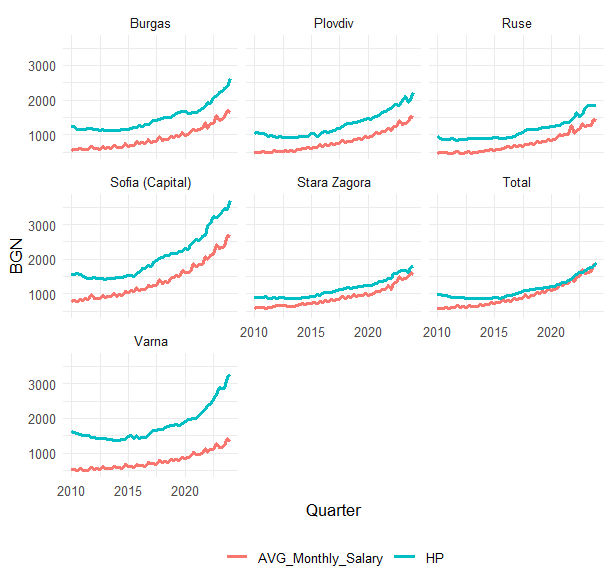

# Dynamics of Bulgarian Housing Prices and Affordability

How do macroeconomic conditions and wages shape housing affordability and house prices in Bulgaria?
This project answers that with two econometric models:

1. **Time series ARDL** – a national Housing Affordability Index (HAI) explained by employment, interest rates and housing supply.
2. **Panel ARDL (PMG / MG)** – the long-run relationship between house prices and average salaries in Bulgaria's six largest cities.

Based on my senior thesis at the American University in Bulgaria (2025), supervised by Prof. Didar Erdinç, and extended in R.

---

## Key results

**Panel model – house prices and salaries (6 cities + national total, 2010Q1–2024Q1)**

| | Mean Group (MG) | Pooled Mean Group (PMG) |
|---|---|---|
| Long-run effect of salary on price per m² | **1.78** (SE 0.30) | 2.81 (SE 0.28) |
| Error correction (speed of adjustment) | **−0.19** | −0.06 |
| Hausman test (H0: PMG is valid) | χ² = 36.2, p < 0.001 → **MG preferred** | |

- In the long run, a 1 BGN increase in the average monthly salary goes together with about **1.8 BGN higher house prices per m²**.
- About **19% of a deviation** from this long-run relationship is corrected every quarter.
- The long-run effect differs across cities (from 1.10 in Stara Zagora to 3.44 in Varna), which is why the Mean Group estimator is preferred.
- Westerlund (2007) cointegration tests with bootstrapped p-values reject "no cointegration" for all four statistics (Gt 0.004, Ga 0.002, Pt 0.046, Pa 0.002).

**Time series model – national Housing Affordability Index (2010Q1–2024Q1)**

- ARDL(2,0,0,0,1,3) model selected by BIC for log HAI on employment rate, mortgage rate, long-term interest rate, construction cost index and new residential construction (all in logs).
- Error-correction coefficient **−0.41**: about 41% of the disequilibrium is corrected each quarter.
- Bounds test (case 3): F = 4.32, p = 0.021 → the null of no cointegration is rejected at the 5% level.
- Long-run elasticities (Newey–West standard errors):

| Variable | Long-run elasticity | p-value |
|---|---|---|
| Mortgage interest rate | **−0.93** | < 0.001 |
| New residential construction (CNRB) | **−1.36** | < 0.001 |
| Construction cost index | **+0.52** | 0.002 |
| Employment rate | +1.38 | 0.127 |
| Long-term interest rate | −0.04 | 0.146 |

- A 1% increase in the mortgage rate lowers long-run affordability by about 0.93%. Employment and the long-term interest rate are not significant, partly due to high multicollinearity between the macroeconomic variables.



---

## Methodology

### Panel model (`code/Panel_model_final.R`)

1. **Cross-sectional dependence** – Pesaran CD test on price and wage changes (CD = 14.2 and 26.9, p < 0.001): the cities move together.
2. **Unit roots** – Im–Pesaran–Shin test (allows each city its own dynamics), also on cross-sectionally demeaned series as a robustness check. Wage changes are strongly seasonal (quarter effects explain 65% of the variation), so they are tested after removing city-specific quarterly means. Both series are I(1).
3. **Cointegration** – Westerlund (2007) error-correction tests with bootstrapped p-values (robust to cross-sectional dependence), plus city-level Pesaran–Shin–Smith bounds tests.
4. **Estimation** – PMG and MG estimators (Pesaran, Shin & Smith, 1999), Hausman test.
5. **Diagnostics per city** – serial correlation (Breusch–Godfrey), heteroskedasticity (Breusch–Pagan), normality (Jarque–Bera), stability (CUSUM), leftover seasonality, and cross-sectional dependence of the residuals.

### Time series model (`code/Project_Econometrics.R`)

1. Unit root tests – ADF and Zivot–Andrews (allows for a structural break).
2. ARDL model with automatic lag selection (BIC), bounds test for cointegration, error-correction model.
3. Diagnostics – Breusch–Godfrey, Breusch–Pagan, Jarque–Bera, Shapiro–Wilk, CUSUM / MOSUM, VIF.
4. Long-run multipliers with Newey–West standard errors.

---

## Improvements over the original thesis

The thesis was estimated in Stata. Re-doing the panel analysis in R led to several corrections:

- **PMG estimate:** Stata's `xtpmg` stopped at a *local* maximum of the likelihood (long-run coefficient 1.60). The likelihood has two peaks; the global maximum is at 2.81. With the correct estimate, the Hausman test rejects PMG, so the conclusion changes from PMG to **MG**.
- **Cointegration test:** Pedroni's residual-based tests were replaced by Westerlund's error-correction tests, which test the same mechanism the PMG/MG models estimate and do not impose the common-factor restriction.
- **Cross-sectional dependence:** tested explicitly (it is strong) and accounted for with bootstrapped p-values and demeaned unit root tests.
- **Seasonality:** strong seasonality in wages (Q4 bonuses) is handled before unit root testing.
- **Diagnostics:** run separately for every city instead of on the pooled residuals.

---

## Limitations

- Heteroskedastic and non-normal residuals in most cities; residual autocorrelation in Plovdiv and Sofia.
- Residuals remain correlated across cities (CD ≈ 5), which PMG and MG do not model.
- Cointegration is strongly supported in some cities (Plovdiv, Ruse) and weaker in others.
- With 7 cross-sections and 57 quarters, panel tests have limited power.

---

## Repository structure

```
├── README.md
├── data/
│   ├── README.md            # sources and variable definitions
│   ├── dataset1.dta         # national time series, 1995Q1–2024Q2 (series start at different dates)
│   ├── paneldataset.dta     # city panel, 1995Q1–2024Q1
│   └── Project.csv          # city-level HAIs, 2010Q1–2024Q1
├── code/
│   ├── Project_Econometrics.R   # time series ARDL model
│   └── Panel_model_final.R      # panel PMG / MG model
└── output/
    └── figures/
```

## How to run

1. Clone or download the repository.
2. Open it as an RStudio project (or set the working directory to the repository folder) – the scripts use paths relative to the repository root, e.g. `data/paneldataset.dta`.
3. Install the packages:

```r
install.packages(c("haven", "tidyverse", "zoo", "plm", "Westerlund", "ardlverse",
                   "tseries", "strucchange", "urca", "ARDL", "lmtest", "car", "sandwich"))
```

4. Run `code/Project_Econometrics.R` and `code/Panel_model_final.R`.

Built with R 4.5.2, `ardlverse` 2.0.3.

---

## Data

Quarterly data from the National Statistical Institute (NSI), the Bulgarian National Bank (BNB) and the ECB Data Portal. See [`data/README.md`](data/README.md) for sources, the construction of the Housing Affordability Index and variable definitions.

## Author

Dimitar Zhelezov · [LinkedIn](https://www.linkedin.com/in/dimitarzhelezov)
